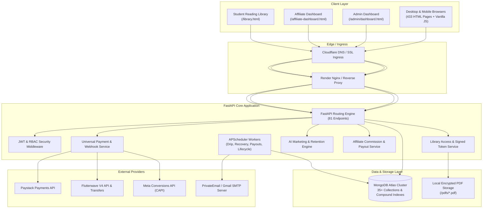

# Existing Architecture Audit

## 1. Executive Summary
The existing platform is an active, production-grade e-commerce, digital publishing, and student education portal operating primarily under the **Scale Group / Academic Comeback** brand. It currently serves customers across Nigeria and international markets with digital book sales, automated curriculum email drips, an affiliate referral network, a sales representative commission system, an SEO content engine (400+ articles), and a customer reading library.

---

## 2. Technology Stack Breakdown

| Layer | Current Implementation | Details / Versions |
| :--- | :--- | :--- |
| **Frontend UI** | Multi-Page Static HTML5 + Vanilla JS | 433 static HTML pages, custom responsive CSS (`blog.css`, inline design tokens), zero JS framework overhead. |
| **Backend API** | Python FastAPI + Uvicorn | Python 3.12/3.13, FastAPI (Starlette), Pydantic v2 schemas, ASGI asynchronous architecture. |
| **Database** | MongoDB (AsyncIO Motor) | MongoDB Atlas cluster in production, local/mock in development. 35+ collections with compound & unique indexes. |
| **Payment Gateways** | Dual Gateway: Paystack + Flutterwave V4 | Paystack (Card, Bank Transfer, USSD; NGN/USD) + Flutterwave V4 (Virtual Accounts, Card, Automated Transfers). |
| **Authentication** | JWT (HS256) + Passlib/Bcrypt | Multi-role authentication: Admin (`require_admin`), Affiliates (`require_affiliate`), Customers (signed library tokens). |
| **Background Jobs** | APScheduler (AsyncIOScheduler) | 5 standalone background schedulers for email queue, abandoned cart recovery, payout batches, renewals, marketing. |
| **Email Delivery** | SMTPLib (SMTPS / STARTTLS) | Jinja2 templates, persistent connection pooling with NOOP revalidation, queue-based rate limiting. |
| **Tracking & Pixels** | Client + Server Meta Conversions API (CAPI) | Dual Meta Pixel (`1033231049261122` and `1075823608450969`) + Server-side HTTP POST purchase/lead dispatch. |
| **Hosting & Deployment** | Render + GitHub CI/CD | Dockerized container deploy on Render, automatic builds triggered on `origin/main` push. |

---

## 3. High-Level Architecture Diagram

---

## 4. Key Strengths of Current Architecture

1. **Lightweight & High Performance:** Zero frontend framework overhead ensures near-instant First Contentful Paint (FCP) on low-bandwidth mobile networks in Nigeria and emerging markets.
2. **Resilient Payment Idempotency:** Payments utilize deterministic references, atomic CAS claims on `pending_payments`, and dual webhook verification (HMAC SHA512 for Paystack, secret hash for Flutterwave). Duplicate purchases and webhook race conditions are prevented.
3. **Massive SEO Organic Reach:** 418 individual blog posts with structured headings, breadcrumb lists, and OpenGraph metadata are already indexed by search engines.
4. **Decoupled Asynchronous Workers:** Background email dispatch, cart recovery, and affiliate payouts run out-of-band via atomic MongoDB queue claiming, ensuring API requests remain fast and responsive.

---

## 5. Architectural Deficiencies & Vulnerabilities

1. **Duplicated Frontend Code:** Without a component-driven framework (like Next.js), headers, navigation menus, checkout modals, tracking scripts, and footers are copy-pasted across 430+ HTML files. Updating navigation requires editing hundreds of files.
2. **Lack of Native Mobile Experience:** Mobile users access the platform via mobile web browsers. There is no offline book reading, no push notification channel, and no native app-store presence on Google Play or Apple App Store.
3. **No Centralized TypeScript Contract:** Frontend JavaScript uses loose `fetch()` calls with untyped JSON payloads. API changes can break client-side rendering without compile-time warnings.
4. **Document Model vs Relational Integrity:** While MongoDB provides schema flexibility, high-value financial data (orders, ledger commissions, payout splits) lacks relational foreign-key integrity constraints enforced at the database engine level.
