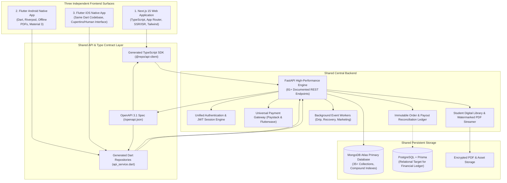

# Target Modern E-Commerce Architecture

## 1. System Vision
The modernized platform transitions from a monolithic static HTML/CSS structure into a **unified three-surface e-commerce ecosystem** powered by a single, shared source of truth.



---

## 2. Platform Uniformity Guarantees

1. **Shared Customer Accounts:** A student registering or purchasing on the Next.js website logs in immediately on Android and iOS using the same credentials or access tokens.
2. **Shared Product Catalogue & Prices:** A product added or updated via the Admin Dashboard synchronizes in real time across the website, Android app, and iOS app.
3. **Shared Purchase & Order History:** An order placed on an Android phone appears immediately on the customer's website dashboard and in the admin sales ledger.
4. **Universal Payment Verification:** Both mobile and web checkouts route through the same backend verification endpoints, ensuring zero price manipulation and idempotent fulfillment.

---

## 3. Project Directory Structure

```text
academic-pack/
├── apps/
│   ├── website/                 # Modern Next.js 15 + TypeScript Web App
│   │   ├── app/                 # App Router (SSR, SSG, ISR)
│   │   ├── components/          # Reusable UI & Checkout Components
│   │   ├── lib/                 # Next.js API client & utilities
│   │   └── public/              # Static assets & optimized WebP images
│   │
│   └── mobile/                  # Cross-Platform Flutter Mobile Application
│       ├── android/             # Android native configuration & Gradle
│       ├── ios/                 # iOS native Xcode project configuration
│       └── lib/
│           ├── core/            # Theme, design tokens, network (Dio), storage
│           ├── features/        # Auth, Catalog, Cart, Checkout, Reader, Affiliates
│           └── main.dart        # Application entrypoint
│
├── backend/                     # Central Python FastAPI High-Performance Backend
│   ├── routes/                  # REST API Endpoints (Admin, Payments, Library, Marketing)
│   ├── services/                # Business logic & payment services
│   ├── workers/                 # Background schedulers (Email, Cart recovery, Payouts)
│   └── database.py              # MongoDB Atlas connection & indexing
│
├── packages/
│   ├── shared-api-contracts/    # OpenAPI v3.1 schema & TypeScript/Dart generators
│   └── shared-documentation/    # Central system documentation & API references
│
└── docs/                        # Architecture, database, SEO & deployment guides
```
